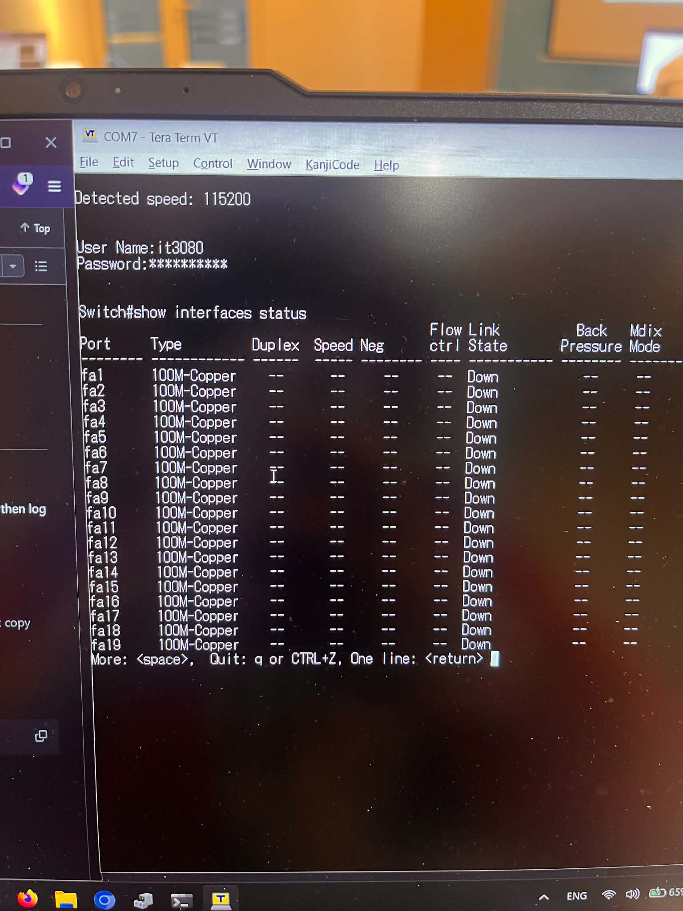

# Lab 02 - Local Area Network

## Devices

- 4 PCs
- Cisco SF350 switch
- 1 console cable and 4 Ethernet (RJ45) cables

## Practice

### 1. Log in

- Use the console cable to connect a PC to the switch (115200 baud, 8 data bits, no parity, 1 stop bit), then log in with the provided username and password.

> The instructions use PuTTY, but I recommend Tera Term on Windows. On GNU/Linux, use whichever serial terminal you prefer (e.g. `screen`, `minicom`, `picocom`).

### 2. Create a VLAN

After logging in, you will be in **privileged mode** (`switch#`). If the prompt is `switch>` instead, type `enable` first.

> **Note:** The switch CLI does not support comments. Type only the commands in the code blocks below. Do not copy any explanation into the terminal.

#### 2.1. How to get the interface names

- In privileged mode:

```sh
show interfaces status
```



- The Cisco SF350 in this lab uses short interface names (no unit/slot prefix):
  - Fast Ethernet ports (100 Mbps): `fa1`, `fa2`, `fa3`,...
  - VLAN interfaces (not physical ports): `vlan 11`, `vlan 12`, `vlan 67`,...
  - Other types: not used in this lab.

#### 2.2. Create a VLAN

- Enter **Global Configuration Mode** (`switch(config)#`) from privileged mode:

```sh
configure terminal
```

- Create a VLAN. `vlan database` changes the prompt to `switch(config-vlan)#`, and `exit` returns to `switch(config)#`:

```sh
vlan database
vlan 67
exit
```

- **(Optional)** Give it a name. `interface vlan 67` changes the prompt to `switch(config-if)#`, and `exit` returns to `switch(config)#`:

```sh
interface vlan 67
name lab
exit
```

#### 2.3. Assign ports to the VLAN (access ports)

> You must be in **Global Configuration Mode** (`switch(config)#`).

- For each port your PCs are connected to, replace `fa1` with your interface name and `67` with the ID of the VLAN you created earlier. The VLAN must be specified by its **ID**, not its name.
- `interface fa1` changes the prompt to `switch(config-if)#`, and `exit` returns to `switch(config)#`:

```sh
interface fa1
switchport mode access
switchport access vlan 67
exit
```

- Repeat the block above for every port. Alternatively, configure several ports at once with `interface range`:

```sh
interface range fa1-4
switchport mode access
switchport access vlan 67
exit
```

- When you are done, go back to privileged mode (`switch#`):

```sh
exit
```

#### 2.4. (Optional) Check the configuration

> You must be in **privileged mode** (`switch#`).

```sh
show vlan
show interfaces switchport fa1
show mac address-table
```

- `show vlan`: VLAN 67 must list `fa1-4` (or the ports you assigned) as untagged.
- `show mac address-table`: after the PCs have pinged each other, their MAC addresses appear in VLAN 67.

> The configuration is only used during the class session. You don't need to (and shouldn't) save it.

### 3. On your PCs

> On Windows, use `ncpa.cpl` (Network Connections) instead of the Settings app.

- **Disconnect every other network** so the Ethernet cable to the switch is the only active connection. This includes Wi-Fi and mobile hotspots, and also **virtual adapters** that stay up when Wi-Fi is off: VMware, VirtualBox, Hyper-V/WSL (`vEthernet`), and VPN software (Radmin VPN, Hamachi, ZeroTier, Tailscale,...). Check in `ncpa.cpl` and disable them. Otherwise, traffic to other subnets may be sent through one of them (see [3.1](#31-a-problem-i-ran-into-on-windows)).
- Manually assign a static IP address and subnet mask to each PC, following the teacher's instructions:
  - **PC1**: 192.168.1.2/24 (subnet mask 255.255.255.0)
  - **PC2**: 192.168.1.3/24 (subnet mask 255.255.255.0)
  - **PC3**: 192.168.254.2/24 (subnet mask 255.255.255.0)
  - **PC4**: 172.168.1.5/16 (subnet mask 255.255.0.0)

> `172.168.0.0/16` is **not** a private range (the private range is `172.16.0.0/12`, i.e. `172.16.x.x` to `172.31.x.x`). It belongs to real hosts on the Internet, which matters if your PC still has another connection to the Internet.

- Leave the default gateway empty. Windows and Linux do not require one.
- Set the network profile to **Private network**.
- **Turn off the firewall for private networks**, or at least allow the inbound rule *File and Printer Sharing (Echo Request - ICMPv4-In)*. Otherwise Windows blocks incoming ping (ICMP echo) requests.
- Test the setup by pinging the other PCs' IP addresses:

  - PC1 pings PC2:

    ```sh
    ping 192.168.1.3
    ```

  - PC2 pings PC3:

    ```sh
    ping 192.168.254.2
    ```

  - PC3 pings PC4:

    ```sh
    ping 172.168.1.5
    ```

- Expected results:

| Case        | Same subnet? | Result |
| ----------- | ------------ | ------ |
| PC1 → PC2   | Yes (192.168.1.0/24) | Success (`Reply from 192.168.1.3: bytes=32 ...`) |
| PC2 → PC3   | No (192.168.1.0/24 vs 192.168.254.0/24) | Fails: no route and no gateway, so the packet is never sent |
| PC3 → PC4   | No (192.168.254.0/24 vs 172.168.0.0/16) | Fails for the same reason |

> All 4 PCs are in the same VLAN, so they are in the same broadcast domain at layer 2. But the IP stack only sends a packet directly (after an ARP request) when the destination is in its own subnet. For any other destination it needs a route, which is usually the default gateway (a router). Without one, the ping fails, even though the cable and the switch work fine.

- Turn the firewall back on after the lab.

#### 3.1. A problem I ran into on Windows

**Symptom** (partly from memory): the ARP cache had been cleared on all 4 PCs, subnet masks were checked, there was no default gateway, and no other network was connected. Still:

- **PC2 → PC3** and **PC4 → PC3** printed `Reply from <IP>: Destination host unreachable`. In at least one of them, `<IP>` was **not** the sender's own IP.
- **PC3 → PC4** printed `Request timed out`.
- Later, with the same setup, a case that had shown `Destination host unreachable` changed to `Request timed out` (not 100% sure).

The expected result for all of these was `PING: transmit failed. General failure.` Nobody (including the TA) knew why.

**What each message means on Windows:**

| Output | What actually happened |
| ------ | ---------------------- |
| `PING: transmit failed. General failure.` | No route to the destination. Nothing is sent. |
| `Reply from <own IP>: Destination host unreachable` | A route exists and its next hop (a gateway, or the destination itself) is on the local link, but **no one answered the ARP request** for that next hop. Nothing goes onto the link except ARP. |
| `Reply from <another IP>: Destination host unreachable` | The packet was sent and **another device** (usually a router) sent back an ICMP error. |
| `Request timed out` | The echo request **was sent** (ARP, if any, succeeded), but no echo reply came back: the destination didn't get it, can't answer it, or a firewall dropped it. |

So in **these** cases the PC had some route to the destination; otherwise it would have printed `General failure`. Clearing the ARP cache doesn't change this, because Windows chooses the route before it sends any ARP request.

> **Help wanted:** If you have found the cause or a fix for this problem, please update this section and contribute it to this repository (commit or pull request), so future students can learn from it.

**Status: unresolved.** These were ruled out: all 4 PCs were personal laptops, `ipconfig` showed only the lab NIC connected and no default gateway, there were no virtual adapters or VPNs, and the subnet masks were correct.

**Key clue:** an ICMP error from an IP that is not the sender's own means **another device really sent a packet back**. In a closed network of 4 PCs and 1 switch, that device can only be one of the other PCs or the switch itself (the SF350 has its own management IP, `192.168.1.254` by default when DHCP gets no answer). And for a device to send an error back, the sender must first have sent it a packet.

**What is still unchecked:**

1. **Who owns `<IP>`.** Right after the ping, run `arp -a` on the sender and find the MAC address of `<IP>`. Compare it with the MAC of each PC (`ipconfig /all`) and of the switch (`show system` or the label on the switch). On the switch, `show ip interface` lists its IP addresses.
2. **The routing table** (`route print -4`). `ipconfig` only shows the default gateway. It doesn't show persistent routes or other routes that could match the destination.
3. **The switch configuration**: whether it has an IP interface in VLAN 67, and whether IP routing is enabled (`show running-config`).
4. **Why the result changed over time.** Neighbor (ARP) cache entries expire and change state, and devices rate-limit the ICMP error messages they send. Either one can turn `Destination host unreachable` into `Request timed out` without any configuration change.
5. **Third-party security software** (antivirus with its own firewall or network filter).

**How to reproduce it without the lab:**

You don't need the switch. Two Windows laptops connected by one Ethernet cable are enough (modern NICs handle a direct cable).

1. Laptop A: `192.168.1.3/24`. Laptop B: `192.168.254.2/24`. No gateway. Wi-Fi off.
2. On A: `ping 192.168.254.2`. Copy the **exact** output.
3. On A, capture with Wireshark during the ping, and also run:

```powershell
ipconfig /all
route print -4
Find-NetRoute -RemoteIPAddress 192.168.254.2
```

4. Repeat with B = `172.168.1.5/16` and ping from a laptop at `192.168.254.2/24`.

In Wireshark, check whether A sends anything at all (ARP or ICMP), and which IP its ARP requests ask for. This shows whether the sender used a route, treated the destination as on-link, or sent nothing.
