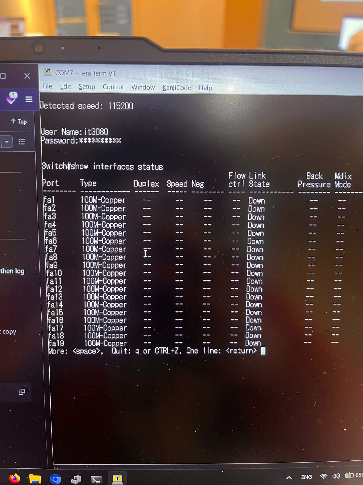

# Lab 02 - Local Area Network (Mạng cục bộ)

## Thiết bị

- 4 PC
- Switch Cisco SF350
- 1 cáp console và 4 cáp Ethernet (RJ45)

## Thực hành

### 1. Đăng nhập

- Sử dụng cáp console để kết nối PC với switch (115200 baud, 8 data bits, không parity, 1 stop bit), sau đó đăng nhập bằng username và mật khẩu được cung cấp.

> Hướng dẫn của trường sử dụng PuTTY, nhưng tôi khuyên dùng Tera Term trên Windows. Trên GNU/Linux, hãy sử dụng bất cứ serial terminal nào bạn thích (`screen`, `minicom`, `picocom`,...).

### 2. Create a VLAN (Tạo VLAN)

Sau khi đăng nhập, bạn sẽ ở **privileged mode** (`switch#`). Nếu dấu nhắc lệnh là `switch>`, hãy gõ `enable` trước.

> **Lưu ý:** Switch CLI không hỗ trợ comments. Chỉ gõ các lệnh trong các khối mã bên dưới. Không sao chép bất kỳ phần giải thích nào vào terminal.

#### 2.1. Cách lấy tên các interface

- Trong privileged mode:

```sh
show interfaces status
```



- Cisco SF350 trong bài lab này sử dụng tên interface dạng ngắn (không có tiền tố unit/slot):
  - Các cổng Fast Ethernet (100 Mbps): `fa1`, `fa2`, `fa3`,...
  - Các interface VLAN (không phải cổng vật lý): `vlan 11`, `vlan 12`, `vlan 67`,...
  - Các loại khác: không dùng trong bài lab này.

#### 2.2. Tạo VLAN

- Vào **Global Configuration Mode** (`switch(config)#`) từ privileged mode:

```sh
configure terminal
```

- Tạo một VLAN. Lệnh `vlan database` đổi dấu nhắc thành `switch(config-vlan)#`, và `exit` quay lại `switch(config)#`:

```sh
vlan database
vlan 67
exit
```

- **(Optional)** Đặt tên cho vlan. `interface vlan 67` đổi dấu nhắc thành `switch(config-if)#`, và `exit` quay lại `switch(config)#`:

```sh
interface vlan 67
name lab
exit
```

#### 2.3. Gán cổng vào VLAN - các cổng access

> Bạn phải đang ở **Global Configuration Mode** (`switch(config)#`).

- Với mỗi cổng mà PC của bạn kết nối vào, hãy thay `fa1` bằng tên interface của bạn, và thay `67` bằng ID của VLAN bạn vừa tạo trước đó. VLAN phải được chỉ định bằng **ID** của nó, không phải tên.
- `interface fa1` đổi dấu nhắc thành `switch(config-if)#`, và `exit` quay lại `switch(config)#`:

```sh
interface fa1
switchport mode access
switchport access vlan 67
exit
```

- Lặp lại quy trình trên cho mọi cổng. Hoặc cách khác, cấu hình nhiều cổng cùng lúc bằng `interface range`:

```sh
interface range fa1-4
switchport mode access
switchport access vlan 67
exit
```

- Khi bạn hoàn tất, quay lại privileged mode (`switch#`):

```sh
exit
```

#### 2.4. (Optional) Kiểm tra cấu hình

> Bạn phải đang ở **privileged mode** (`switch#`).

```sh
show vlan
show interfaces switchport fa1
show mac address-table
```

- `show vlan`: VLAN 67 phải hiển thị `fa1-4` (hoặc các cổng bạn đã gán) ở trạng thái untagged.
- `show mac address-table`: sau khi các PC đã ping lẫn nhau, các địa chỉ MAC của chúng sẽ xuất hiện trong VLAN 67.

> Cấu hình chỉ được sử dụng trong buổi học. Bạn không cần (và không nên) lưu nó lại.

### 3. Trên các máy tính của bạn

> Trên Windows, sử dụng `ncpa.cpl` (Network Connections) thay vì ứng dụng Settings.

- **Ngắt kết nối mọi mạng khác** để cáp Ethernet nối vào switch là kết nối hoạt động duy nhất. Tắt toàn bộ WiFi, mobile hotspot, và các virtual adapter (VMware, VirtualBox, WSL, các phần mềm VPN,...). Kiểm tra trong `ncpa.cpl` và vô hiệu hóa chúng. Nếu không, lưu lượng truy cập tới các subnet khác có thể bị định tuyến qua một trong số chúng (xem [3.1](#31-a-problem-i-ran-into-on-windows)).
- Gán thủ công một địa chỉ IP tĩnh và subnet mask cho mỗi PC, theo hướng dẫn của giảng viên và tài liệu của trường:
  - **PC1**: 192.168.1.2/24
  - **PC2**: 192.168.1.3/24
  - **PC3**: 192.168.254.2/24
  - **PC4**: 172.168.1.5/16

> `172.168.0.0/16` **không phải** là một dải private (dải private là `172.16.0.0/12`, nghĩa là từ `172.16.x.x` đến `172.31.x.x`). Điều này quan trọng nếu PC của bạn vẫn còn kết nối khác ra Internet.

- Để trống default gateway. Windows và Linux không bắt buộc phải có (Windows Settings bắt buộc, nhưng hãy dùng ncpa.cpl)
- Đặt cấu hình mạng thành **Private network**.
- **Tắt tường lửa (firewall) cho mạng private**, hoặc ít nhất cho phép quy tắc inbound *File and Printer Sharing (Echo Request - ICMPv4-In)*. Nếu không, Windows sẽ chặn các yêu cầu ping đến (ICMP echo).
- Kiểm tra thiết lập bằng cách ping đến các địa chỉ IP của PC khác:

  - PC1 ping PC2:

    ```sh
    ping 192.168.1.3
    ```

  - PC2 ping PC3:

    ```sh
    ping 192.168.254.2
    ```

  - PC3 ping PC4:

    ```sh
    ping 172.168.1.5
    ```

- Kết quả mong đợi:

| Trường hợp | Cùng subnet không? | Kết quả |
| ----------- | ------------ | ------ |
| PC1 → PC2   | Có (192.168.1.0/24) | Thành công (`Reply from 192.168.1.3: bytes=32 ...`) |
| PC2 → PC3   | Không (192.168.1.0/24 so với 192.168.254.0/24) | Thất bại: không có route và không có gateway, nên gói tin không bao giờ được gửi đi |
| PC3 → PC4   | Không (192.168.254.0/24 so với 172.168.0.0/16) | Thất bại vì lý do tương tự |

> Cả 4 PC đều nằm trong cùng một VLAN, nên chúng nằm trong cùng một broadcast domain ở layer 2. Nhưng IP stack chỉ gửi trực tiếp một gói tin (sau một yêu cầu ARP) khi đích đến nằm trong cùng subnet của nó. Đối với bất kỳ đích đến nào khác, nó cần một route, thường là default gateway (một router). Không có nó, lệnh ping sẽ thất bại, mặc dù cáp và switch vẫn hoạt động tốt.

- Bật lại tường lửa sau khi xong bài lab.

#### 3.1. Một vấn đề tôi gặp phải trên Windows

**Vấn đề** (Theo mình nhớ): Bảng ARP đã được xóa trên cả 4 PC, subnet mask đã được kiểm tra, không có default gateway, và không có mạng nào khác được kết nối. Tuy nhiên:

- **PC2 → PC3** và **PC4 → PC3** hiển thị `Reply from <IP>: Destination host unreachable`. Trong ít nhất một trường hợp, `<IP>` **không phải** là IP của chính máy gửi.
- **PC3 → PC4** hiển thị `Request timed out`.
- Sau đó, với cùng thiết lập đó, ít nhất một trường hợp từng hiển thị `Destination host unreachable` đã chuyển thành `Request timed out` (không chắc chắn 100%).

Kết quả mong đợi cho tất cả các trường hợp này là `PING: transmit failed. General failure`.

**Ý nghĩa của từng thông báo trên Windows:**

| Đầu ra | Điều gì thực sự đã xảy ra |
| ------ | ---------------------- |
| `PING: transmit failed. General failure.` | Không có route đến đích. Không có gì được gửi đi. |
| `Reply from <own IP>: Destination host unreachable` | Một route tồn tại và hop kế tiếp của nó (một gateway, hoặc chính đích đến) nằm trên local link, nhưng **không ai phản hồi yêu cầu ARP** cho hop kế tiếp đó. Không có gì đi lên link ngoại trừ ARP. |
| `Reply from <another IP>: Destination host unreachable` | Gói tin đã được gửi đi và **một thiết bị khác** (thường là router) đã gửi trả lại một lỗi ICMP. |
| `Request timed out` | Yêu cầu echo **đã được gửi** (ARP, nếu có, thành công), nhưng không có phản hồi echo nào quay lại: đích đến không nhận được, không thể trả lời, hoặc tường lửa đã thả trôi (drop) nó. |

Vì vậy, trong **những** trường hợp này, PC có một số route tới đích; nếu không, nó đã hiển thị `General failure`. Việc xóa bộ nhớ đệm ARP không thay đổi điều này, bởi vì Windows chọn route trước khi nó gửi bất kỳ yêu cầu ARP nào.

> **Cần giúp đỡ:** Nếu bạn tìm ra nguyên nhân hoặc cách khắc phục cho vấn đề này, hãy cập nhật phần này và commit hoặc pull request, để các sinh viên khóa sau có thể sử dụng nó.

---
**Trạng thái: chưa được giải quyết.** Những nguyên nhân sau đã bị loại trừ: cả 4 PC đều là laptop cá nhân, `ipconfig` chỉ hiển thị NIC của bài lab đang kết nối và không có default gateway, không có virtual adapter hoặc VPN nào, và subnet mask hoàn toàn chính xác.

**1 vấn đề cần lưu ý:** một lỗi ICMP từ một IP không phải của chính máy gửi có nghĩa là **một thiết bị khác thực sự đã gửi gói tin phản hồi**. Trong một mạng khép kín gồm 4 PC và 1 switch, thiết bị đó chỉ có thể là một trong các PC khác hoặc chính switch đó (SF350 có IP quản lý riêng, mặc định là `192.168.1.254` khi DHCP không nhận được phản hồi). Và để một thiết bị gửi lỗi trả lại, máy gửi trước đó phải đã gửi cho nó một gói tin.

**Những gì vẫn chưa được kiểm tra:**

1. **Máy nào giữ `<IP>`.** Ngay sau khi ping, chạy `arp -a` trên máy gửi và tìm địa chỉ MAC của `<IP>`. So sánh nó với MAC của từng PC (`ipconfig /all`) và của switch (`show system` hoặc nhãn dán trên switch). Trên switch, `show ip interface` liệt kê các địa chỉ IP của nó.
2. **Bảng định tuyến (routing table)** (`route print -4`). `ipconfig` chỉ hiển thị default gateway. Nó không hiển thị persistent route hoặc các route khác có thể khớp với đích đến.
3. **Cấu hình switch**: liệu nó có một IP interface trong VLAN 67 hay không, và IP routing có được bật hay không (`show running-config`).
4. **Tại sao kết quả thay đổi theo thời gian.** Các mục trong neighbor (ARP) cache hết hạn và thay đổi trạng thái, và các thiết bị giới hạn tốc độ (rate-limit) các thông báo lỗi ICMP mà chúng gửi đi. Cả hai điều này đều có thể biến `Destination host unreachable` thành `Request timed out` mà không cần thay đổi cấu hình nào.
5. **Phần mềm bảo mật của bên thứ ba** (phần mềm diệt virus có tường lửa riêng hoặc network filter).

**Cách tái tạo vấn đề mà không cần dùng switch:**

Bạn không cần switch. Hai laptop Windows kết nối bằng một cáp Ethernet là đủ (các NIC hiện đại tự xử lý cáp thẳng/chéo).

1. Laptop A: `192.168.1.3/24`. Laptop B: `192.168.254.2/24`. Không có gateway. Tắt Wi-Fi.
2. Trên A: `ping 192.168.254.2`. Ghi lại kết quả.
3. Trên A, bắt gói tin bằng Wireshark trong lúc ping, và đồng thời chạy:

```powershell
ipconfig /all
route print -4
Find-NetRoute -RemoteIPAddress 192.168.254.2
```

4. Lặp lại với B = `172.168.1.5/16` và ping từ laptop có IP `192.168.254.2/24`.

Trong Wireshark, kiểm tra xem A có gửi bất kỳ thứ gì không (ARP hay ICMP), và yêu cầu ARP của nó hỏi địa chỉ IP nào. Điều này cho thấy liệu máy gửi có sử dụng route hay không, coi đích đến nằm trên link hay không, hay không gửi gì cả.
